# DrGodly Pharmacy Assist — Requirements Locking Document

## Document Information
- **Project:** DrGodly Pharmacy Assist
- **Version:** 1.0.0 (Production Release Target)
- **Status:** LOCKED
- **Jurisdiction:** India (CDSCO 2026, NMC Telemedicine Guidelines 2020, DPDP Act 2023, ABDM R4)
- **Ecosystem:**
  - Frontend Base: `https://github.com/Yazhnimalan/bezs-hms` (Next.js 16, React 19, Tailwind CSS v4)
  - Backend FHIR: `https://github.com/naveenraj-g/fhir.git` (FastAPI FHIR R4 server & MCP gateway)
  - Active Working Repo: `https://github.com/pranjalchirmade09326-hash/Pharmacy-App-for-DrGodly.git`

---

## 1. Core Pages Blueprint

The application consists of 6 core production pages structured for both customer-facing interaction and in-pharmacy clinical triage:

| # | Route | Page Title | Primary Actor | Core Purpose |
|---|---|---|---|---|
| 1 | `/` | Home / Pharmacy Counter & AI Intake Landing | Health Consumer / Pharmacy Patient | Displays counter QR poster (`tel:+918069000000`), 1-tap call-to-intake, live AI clinical intake simulation, language selector (Hindi, English, Tamil, Telugu), and pharmacy store switcher. |
| 2 | `/doctors` | Doctor Teleconsultation Discovery | Patient / Pharmacist Escorting Patient | Search and filter registered medical practitioners (RMPs) by specialty (General Medicine, Pulmonology, Pediatrics, Gastro), fee range, language, and immediate slot availability. |
| 3 | `/doctors/[id]` | Doctor Profile & Interactive Slot Booking | Patient / Pharmacist Escorting Patient | Detailed view of doctor's NMC registration number, degrees, clinical experience, consultation fees, live calendar date picker, interactive morning/evening slot chips, and appointment confirmation. |
| 4 | `/catalog` | CDSCO-Compliant OTC & Health Catalog | Customer / Pharmacist | Curated catalog of OTC supplements, antacids, ORS, vitamins, and first aid. Clear visual badges indicating "OTC Safe" vs "Schedule H / H1 - Prescription Required". |
| 5 | `/checkout` | Dispense & Order Checkout System | Customer / Pharmacist | Cart itemization, prescription upload & gate for restricted schedules, patient delivery address or in-store pickup toggle, CGST/SGST 12% calculation, and order confirmation. |
| 6 | `/pharmacy/workspace` | Pharmacist 4-Column Clinical Triage Console | Licensed Registered Pharmacist | Clinical inbox of voice intake sessions, AI SBAR symptom summary, red-flag triaging (Red/Orange/Yellow/Green), deterministic CDSCO formulary protocol recommendations, teleconsultation escalation, and WhatsApp report dispatch. |

---

## 2. Data Fields Blueprint

### 2.1 Doctor Card & Profile (`/doctors`, `/doctors/[id]`)
Mandatory fields required by NMC Telemedicine Guidelines 2020:
- `id` (`string`, UUID): Unique doctor identifier.
- `fullName` (`string`): e.g., "Dr. Rajesh K. Sharma".
- `degrees` (`string[]`): e.g., `["MBBS", "MD (General Medicine)"]`.
- `nmcRegistrationNumber` (`string`): Mandatory National Medical Commission registration (e.g., `NMC-MCI-2014-48291`).
- `stateMedicalCouncil` (`string`): e.g., "Delhi Medical Council".
- `specialization` (`string`): e.g., "Internal Medicine / General Physician".
- `experienceYears` (`number`): Years in active clinical practice.
- `languages` (`string[]`): e.g., `["Hindi", "English", "Punjabi"]`.
- `consultationFeeINR` (`number`): e.g., `₹499`.
- `rating` (`number`): 1.0 to 5.0 (e.g., `4.9`).
- `reviewCount` (`number`): Total patient consultations reviewed.
- `avatarUrl` (`string`): Profile image path.
- `aboutBio` (`string`): Clinical bio, clinical interests, and hospital affiliations.
- `availableToday` (`boolean`): Whether current day slots are open.
- `nextAvailableSlot` (`string`): e.g., "Today, 04:30 PM".
- `slots` (`Slot[]`): Array of `{ slotId, date, time, period: 'morning' | 'afternoon' | 'evening', isBooked }`.

### 2.2 Product Catalog Item (`/catalog`)
Mandatory fields under CDSCO 2026 regulations:
- `id` (`string`, UUID): Unique product SKU.
- `brandName` (`string`): e.g., "Electral Oral Rehydration Salts".
- `genericComposition` (`string`): e.g., "Sodium Chloride 2.6g, Potassium Chloride 1.5g, Sodium Citrate 2.9g, Dextrose 13.5g".
- `cdscoCategory` (`'OTC' | 'SCHEDULE_H_RESTRICTED' | 'SUPPLEMENT' | 'AYUSH'`): Regulatory scheduling classification.
- `prescriptionRequired` (`boolean`): If `true`, requires valid RMP prescription before checkout.
- `packSize` (`string`): e.g., "21.8g Sachet (Pack of 5)".
- `mrpINR` (`number`): Maximum retail price.
- `sellingPriceINR` (`number`): Discounted pharmacy selling price.
- `inStock` (`boolean`): Inventory availability status.
- `stockCount` (`number`): Quantity available in local store.
- `dosageInstructions` (`string`): Plain-language usage directions.
- `safetyWarnings` (`string[]`): e.g., `["Do not administer to infants under 4 without pediatric consultation", "Contraindicated in severe renal impairment"]`.
- `category` (`'digestive' | 'respiratory' | 'pain_fever' | 'supplements' | 'first_aid'`): Consumer filter segment.

### 2.3 Checkout & Order Blueprint (`/checkout`)
- `orderId` (`string`): Unique dispense reference (e.g., `ORD-2026-8941`).
- `pharmacyStoreId` (`string`): Store location ID (e.g., `PHARM-DEL-041`).
- `patientDetails`: `{ name, phone, age, gender, deliveryAddress, pickupMode: 'STORE_PICKUP' | 'HOME_DELIVERY' }`.
- `cartItems`: Array of `{ productId, brandName, genericComposition, unitPriceINR, quantity, prescriptionRequired }`.
- `subtotalINR` (`number`): Sum of item prices.
- `cgstINR` (`number`): Central GST (6%).
- `sgstINR` (`number`): State GST (6%).
- `totalAmountINR` (`number`): Final payable amount.
- `prescriptionUploadUrl` (`string | null`): Required if any cart item has `prescriptionRequired: true`.
- `telemedicineReferralId` (`string | null`): Linked teleconsultation ID if RMP referred.

### 2.4 Pharmacist Clinical Intake Triage Card (`/pharmacy/workspace`)
- `intakeId` (`string`): Session ID (e.g., `INTAKE-2026-0042`).
- `patient`: `{ name, age, gender, phone, language }`.
- `timestamp`: Call completion time.
- `triageLevel`:
  - `RED`: Immediate emergency (Chest pain, anaphylaxis, acute stridor) $\rightarrow$ Call 108 / Emergency ER.
  - `ORANGE`: Severe symptoms requiring urgent same-day Doctor evaluation.
  - `YELLOW`: Mild/moderate symptoms; doctor teleconsult recommended or safe protocolized OTC.
  - `GREEN`: Minor self-limiting symptom; safe OTC symptomatic relief per CDSCO formulary.
- `chiefComplaint`: Patient's own words.
- `sbarSummary`: Structured Situation, Background, Assessment, Recommendation.
- `differentialDiagnoses`: Ranked differential hypotheses with likelihood and ICD-10 code.
- `investigationsRecommended`: Suggested diagnostic tests (e.g., CBC, Serum Electrolytes).
- `cdscoFormularyOptions`: Deterministic medications validated against CDSCO age/schedule rules.
- `pharmacistDecision`: `{ action: 'DISPENSE_OTC' | 'TELECONSULT_DOCTOR' | 'ORDER_LABS' | 'EMERGENCY_ESCALATION', notes, rphLicenseNo }`.

---

## 3. User Actions Map

```mermaid
flowchart TD
    subgraph Consumer Journey
        A[Customer at Pharmacy] -->|Scans QR Poster| B[Phone Opens Dialer: tel:+918069000000]
        B -->|Taps Call| C[AI Voice Intake Call]
        C -->|Captures Demographics & SBAR Symptoms| D[Call Ends & WhatsApp Summary Sent]
        D -->|Clicks WhatsApp Link| E[Browse Recommended OTC Products /catalog]
        D -->|Clicks Doctor Referral| F[Doctor Search & Booking /doctors]
        F -->|Selects Doctor| G[Doctor Profile & Slot Picker /doctors/id]
        G -->|Selects Slot & Confirms| H[Teleconsultation Booked]
        E -->|Adds to Cart| I[Checkout /checkout]
        I -->|Uploads Rx if required & Confirms| J[Dispense Token Generated]
    end

    subgraph Pharmacist Workspace Journey
        K[Pharmacist Console /pharmacy/workspace] -->|Real-time Socket Update| L[New Intake in Queue]
        L -->|Clicks Patient Card| M[Inspect 4-Column Clinical Summary]
        M -->|Reviews Red Flags| N{Is Triage Red/Critical?}
        N -->|Yes| O[Trigger Emergency Escalation / Ambulance 108]
        N -->|No| P[Review Differential & CDSCO Formulary]
        P -->|Selects Action| Q[Dispense OTC / Schedule RMP Teleconsult / Order Diagnostic Labs]
        Q -->|Approves & Signs| R[Dispatches Final Verified Report to WhatsApp & FHIR Sync]
    end
```

### 3.1 Interaction Triggers & State Behaviors
1. **Slot Selection on Doctor Profile (`/doctors/[id]`):**
   - User clicks any time slot chip (e.g., "10:30 AM").
   - Action: Selected chip toggles to active state (`border-teal-600 bg-teal-50 text-teal-800 font-semibold ring-2 ring-teal-500/20`).
   - Selected slot text and timestamp display immediately in the appointment summary card with live fee calculation.
2. **Category Filter on Product Catalog (`/catalog`):**
   - User clicks category pill (e.g., "Digestive Care").
   - Action: Active pill highlights in Teal; product grid filters without page reload.
3. **Emergency Red Flag Escalation:**
   - In Pharmacist Workspace, when an intake card with `RED` triage is selected, an amber/red blinking emergency banner locks the screen with direct "Call 108 Ambulance" and "Escalate to Senior RMP" buttons.
4. **Prescription Gate on Checkout (`/checkout`):**
   - If cart contains Schedule H item, a blue upload banner opens prompting "Upload Doctor Prescription (NMC-approved RMP)". Checkout button is conditionally disabled until either prescription is uploaded or teleconsultation is scheduled.
