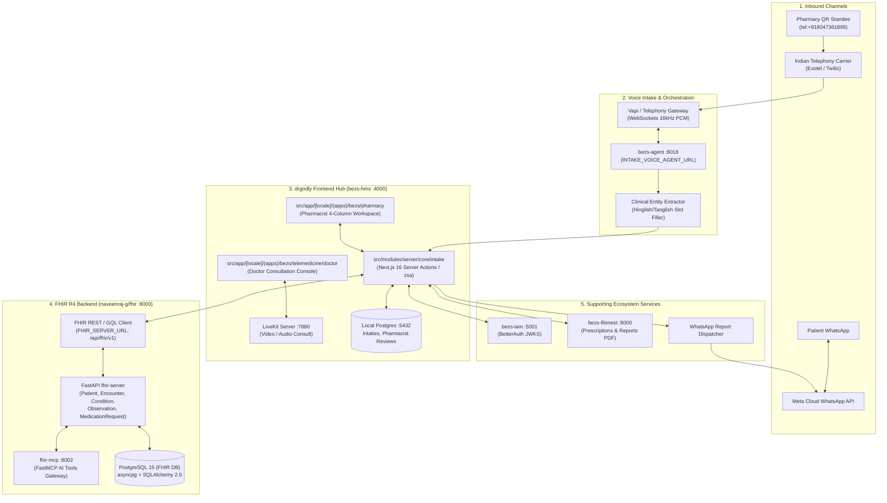
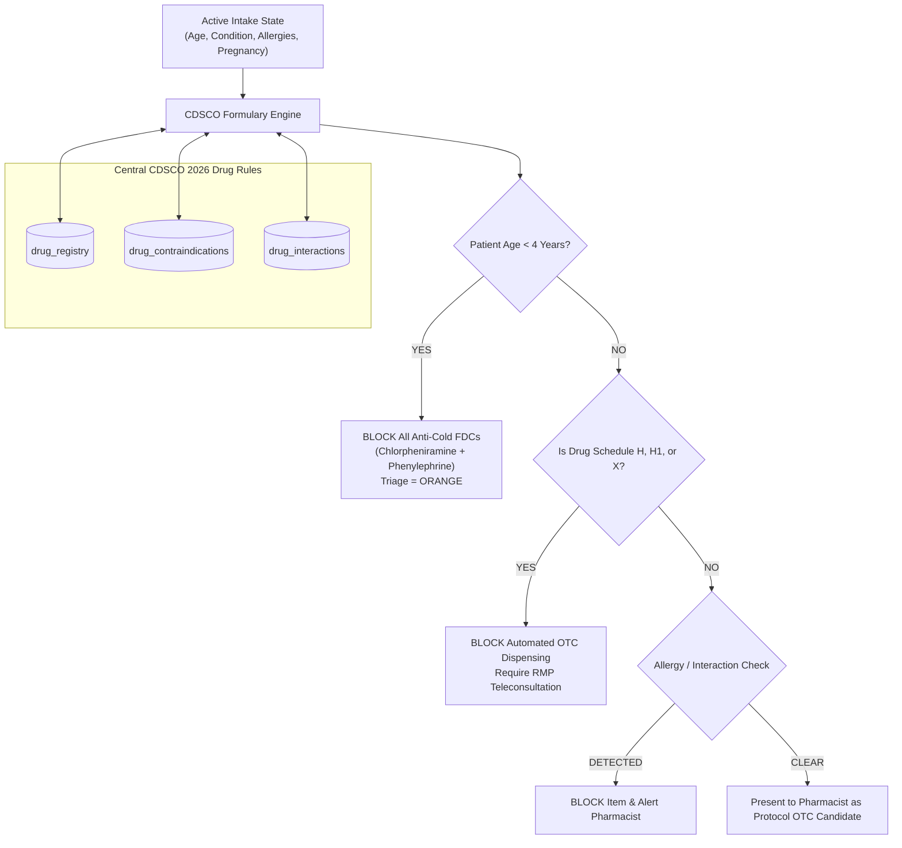

# DrGodly Pharmacy Assist — System Architecture & Technical Design Document
**Document ID:** DRG-ARCH-2026-V2  
**Product:** DrGodly Pharmacy Assist  
**Ecosystem Integration:**  
* **Frontend / HMS Hub:** [`Yazhnimalan/bezs-hms`](https://github.com/Yazhnimalan/bezs-hms) (Next.js 16 App Router, React 19, Prisma, Tailwind v4, LiveKit, Vapi)
* **Backend / FHIR Server:** [`naveenraj-g/fhir`](https://github.com/naveenraj-g/fhir.git) (FastAPI + SQLAlchemy 2.0 + PostgreSQL 15, FHIR R4 REST API)
* **AI Agent Platform:** [`Yazhnimalan/bezs-agent`](https://github.com/Yazhnimalan/bezs-agent) & [`fhir-mcp`](https://github.com/naveenraj-g/fhir/tree/main/fhir-mcp) (FastMCP at `:8002/mcp`)
* **IAM / Auth:** [`Yazhnimalan/bezs-iam`](https://github.com/Yazhnimalan/bezs-iam) (BetterAuth at `:5001`)
* **Storage / PDFs:** [`Yazhnimalan/bezs-filenest`](https://github.com/Yazhnimalan/bezs-filenest) (FileNest at `:8000`)
**Jurisdiction:** India (Compliant with CDSCO 2026, DPDP Act 2023, Telemedicine Practice Guidelines 2020, ABDM FHIR R4)  

---

## 1. High-Level Architectural Topology

DrGodly Pharmacy Assist builds natively on top of the **DrGodly / Bezs Healthcare Ecosystem**. Rather than introducing a siloed tech stack, Pharmacy Assist plugs directly into the existing Next.js 16 App Router frontend (`bezs-hms`), the FastAPI FHIR R4 backend (`naveenraj-g/fhir`), and the LiveKit/Vapi/FileNest infrastructure.



---

## 2. Integration Alignment with Core Repositories

### 2.1 Frontend: `Yazhnimalan/bezs-hms` (DrGodly HMS)
* **Framework:** Next.js 16.2.4 (App Router) + React 19.2.4 + TypeScript + Tailwind CSS v4.
* **Component Architecture:** Radix UI, shadcn, Lucide/Remixicon icons, Framer Motion, Recharts.
* **Clean Architecture Layout:**
  * Client modules in `src/modules/client/`: UI components, Zustand stores, TanStack React Query v5.
  * Server modules in `src/modules/server/core/`: Resource controllers, usecases, domain interfaces, and infrastructure repositories wired via `@evyweb/ioctopus` Dependency Injection.
  * Server Actions via `zsa` and `zsa-react`.
* **Pharmacy Workspace Mounting:**
  * Mounted under the localized route: `src/app/[locale]/(apps)/bezs/pharmacy`.
  * Integrates with `src/modules/server/core/intake` and a new dedicated `src/modules/server/core/pharmacy` module.
  * Telemedicine doctor escalation directly invokes `src/modules/server/core/consultation` and the LiveKit room provisioning pipeline (`@livekit/components-react`).
* **Document Handling:** PDF reports and signed e-prescriptions store in FileNest via `@filenest-fs/nextjs`.

### 2.2 Backend: `naveenraj-g/fhir` (FHIR R4 Platform)
* **Framework:** Python 3.12+, FastAPI, Uvicorn, SQLAlchemy 2.0, asyncpg, Redis 7, uv.
* **API Endpoints:** Mounted at `/api/fhir/v1/<resource>`.
* **Clinical Data Mapping:**
  * Every pharmacy walk-in maps to:
    1. `POST /api/fhir/v1/Patient`: Search/create patient using phone number CLI as identifier.
    2. `POST /api/fhir/v1/Encounter`: Class `AMB` (Ambulatory / Pharmacy visit), linked to pharmacy `Organization`.
    3. `POST /api/fhir/v1/Observation`: Extracted symptoms (LOINC/SNOMED), duration, body site, and cleared red flags.
    4. `POST /api/fhir/v1/Condition`: AI differential considerations (ICD-10 provisional codes).
    5. `POST /api/fhir/v1/ServiceRequest`: Suggested lab investigations (LOINC).
    6. `POST /api/fhir/v1/MedicationRequest`: Pharmacist-dispensed OTC items or Doctor-issued e-prescriptions.
    7. `POST /api/fhir/v1/AuditEvent`: Immutable compliance event tracking.
* **AI Tool Integration (`fhir-mcp`):** Exposes all FHIR endpoints to AI agents over streamable-HTTP at `:8002/mcp`.

---

## 3. Decoupled 3-Tier Intelligence Architecture

```
┌────────────────────────────────────────────────────────────────────────┐
│                        TIER 1: CONVERSATIONAL AI                       │
│  • Voice Ingestion via Vapi / Telephony Gateway                        │
│  • Speech recognition (STT) across Indian accents & code-switching     │
│  • Slot filling via bezs-agent (INTAKE_VOICE_AGENT_URL :8018)          │
│  • ZERO clinical authority: Cannot prescribe, triage, or diagnose     │
└───────────────────────────────────┬────────────────────────────────────┘
                                    │ Structured Clinical Slots (JSON)
                                    ▼
┌────────────────────────────────────────────────────────────────────────┐
│                   TIER 2: DETERMINISTIC CLINICAL ENGINE                │
│  • Versioned Protocol Runner (protocols/*.json)                        │
│  • Deterministic Red-Flag Triage Gatekeeper (RED / ORANGE / YELLOW)    │
│  • Centrally Managed CDSCO 2026 Medication Formulary Filter            │
│  • Pediatric FDC anti-cold restriction (<4 years ban)                  │
│  • Zero LLM veto power; hard-coded safety logic                        │
└───────────────────────────────────┬────────────────────────────────────┘
                                    │ Triage Level & FHIR Bundle
                                    ▼
┌────────────────────────────────────────────────────────────────────────┐
│                 TIER 3: HUMAN HEALTHCARE PROFESSIONAL                  │
│  • Pharmacist Console (bezs-hms): 4-column review, OTC dispense audit  │
│  • Doctor Telemedicine (LiveKit): Video consult, SOAP note, digital Rx │
│  • Laboratory Network: NABL accredited diagnostic test fulfillment     │
└────────────────────────────────────────────────────────────────────────┘
```

---

## 4. Extended Prisma Schema (Local Application Data)

In `bezs-hms/prisma/schema/schema.prisma`, the local database stores proprietary pharmacy workflow data, linking to FHIR resources by ID:

```prisma
model Pharmacy {
  id              String             @id @default(uuid())
  code            String             @unique // e.g. 'DRG-BLR-001'
  name            String
  license_number  String             // State Drug Control Drug License (DL 20/21)
  address         String
  city            String
  state           String
  pincode         String
  latitude        Float?
  longitude       Float?
  phone_number    String
  inbound_did     String             // Mapped telephone virtual DID
  is_active       Boolean            @default(true)
  created_at      DateTime           @default(now())
  updated_at      DateTime           @updatedAt
  
  reviews         PharmacistReview[]
  qr_codes        PharmacyQrCode[]

  @@map("pharmacies")
}

model PharmacyQrCode {
  id              String   @id @default(uuid())
  pharmacy_id     String
  code_identifier String   @unique // e.g. 'QR-PH001-COUNTER1'
  counter_label   String   @default("Main Counter")
  tel_number      String   // e.g. '+918047361899'
  scans_count     Int      @default(0)
  is_active       Boolean  @default(true)
  created_at      DateTime @default(now())

  pharmacy        Pharmacy @relation(fields: [pharmacy_id], references: [id], onDelete: Cascade)

  @@map("pharmacy_qr_codes")
}

enum PharmacyTriageLevel {
  RED
  ORANGE
  YELLOW
  GREEN
  UNABLE_TO_ASSESS
}

enum PharmacistAction {
  DISPENSED_OTC
  ESCALATED_DOCTOR
  REFERRED_EMERGENCY
  COUNSELED_ONLY
}

model PharmacistReview {
  id                  String             @id @default(uuid())
  intake_id           Int                @unique
  pharmacy_id         String
  pharmacist_user_id  String             // BetterAuth User ID
  triage_level        PharmacyTriageLevel
  allergies_verified  Boolean            @default(false)
  red_flags_checked   Boolean            @default(false)
  action_taken        PharmacistAction
  dispensed_items     Json?              // [{ generic_name, dosage, quantity }]
  counseling_notes    String?
  created_at          DateTime           @default(now())

  pharmacy            Pharmacy           @relation(fields: [pharmacy_id], references: [id])

  @@map("pharmacist_reviews")
}
```

---

## 5. Centrally Managed CDSCO 2026 Medication Engine Architecture

The medication safety engine interacts with `fhir-server` and central CDSCO records to validate every candidate drug before displaying it to the pharmacist:



---

## 6. Pharmacist Console UI Layout in `bezs-hms`

Mounted under `src/app/[locale]/(apps)/bezs/pharmacy`:
* **Header:** Pharmacy Selector (multi-store switcher), Active On-Call Doctor Pill, Emergency Counters.
* **Intake Queue Table:** Reuses `@tanstack/react-table` from `src/modules/shared/components/tables`, color-coded by triage level (`RED`, `ORANGE`, `YELLOW`, `GREEN`, `UNABLE_TO_ASSESS`).
* **4-Column Clinical Review Screen:**
  * Col 1: Patient Details + Audio Playback (Vapi recording URL).
  * Col 2: Chief Complaint, Timeline, and Relevant Negatives.
  * Col 3: AI Safety Review (screened red flags with green checkmarks) and ICD-10 differentials.
  * Col 4: Action Panel ([Dispense OTC], [Doctor Teleconsultation], [Recommend Lab], [Emergency Referral]).
* **One-Tap Doctor Escalation:** Invokes `createConsultation` server action, creates LiveKit video room, and sends WhatsApp link to the patient.

---

## 7. FHIR R4 Synchronizer Specification

When an intake completes, the `FhirSyncService` dispatches typed payloads to `naveenraj-g/fhir`:

```typescript
// Example: Creating FHIR Encounter from DrGodly Pharmacy Intake
export async function syncPharmacyEncounterToFhir(intake: IntakePayload) {
  const fhirClient = getFhirClient(); // Authenticated with JWKS Bearer token

  // 1. Ensure Patient exists in FHIR server
  const patientFhirId = await fhirClient.findOrCreatePatient({
    phone: intake.patient_phone,
    name: intake.patient_name,
    gender: intake.patient_gender,
    birthDate: intake.patient_dob,
  });

  // 2. Create FHIR Encounter
  const encounter = await fhirClient.post('/api/fhir/v1/Encounter', {
    resourceType: 'Encounter',
    status: 'finished',
    class: {
      system: 'http://terminology.hl7.org/CodeSystem/v3-ActCode',
      code: 'AMB',
      display: 'Ambulatory Pharmacy Intake',
    },
    subject: { reference: `Patient/${patientFhirId}` },
    serviceProvider: { reference: `Organization/${intake.pharmacy_code}` },
    period: { start: intake.call_started_at, end: intake.call_ended_at },
  });

  // 3. Post Extracted Observations (Symptoms & Negatives)
  for (const symptom of intake.symptoms) {
    await fhirClient.post('/api/fhir/v1/Observation', {
      resourceType: 'Observation',
      status: 'final',
      code: {
        coding: [{ system: 'http://snomed.info/sct', code: symptom.snomed_code, display: symptom.name }],
      },
      subject: { reference: `Patient/${patientFhirId}` },
      encounter: { reference: `Encounter/${encounter.id}` },
      valueString: `Duration: ${symptom.duration_days} days | Severity: ${symptom.severity_score}/10`,
    });
  }

  return { fhirEncounterId: encounter.id, patientFhirId };
}
```

---

## 8. Decoupled 4-Prompt AI Voice Orchestration Layer

To eliminate single-prompt hallucinations, DrGodly strictly partitions conversational intake across four dedicated prompt services:

```
[Spoken Audio Stream] ──► [Vapi Gateway]
                                │
                                ▼
 ┌─────────────────────────────────────────────────────────────┐
 │ Prompt 1: Conversation Controller                           │
 │ • Indian empathy; language detection (HI, EN, TA, TE, MR)   │
 │ • Enforces DPDP consent; asks ONE single question at a time │
 │ • ZERO diagnostic authority; strictly navigates dialogue   │
 └──────────────────────────────┬──────────────────────────────┘
                                │ Spoken Turns Transcript
                                ▼
 ┌─────────────────────────────────────────────────────────────┐
 │ Prompt 2: Clinical Entity Extractor                         │
 │ • Extracts structured concepts into SBAR JSON schema        │
 │ • Maps chief complaint, duration, severity scale (1-10)     │
 │ • Identifies relevant negatives, chronic history, allergies │
 └──────────────────────────────┬──────────────────────────────┘
                                │ Structured Clinical JSON
                                ▼
 ┌─────────────────────────────────────────────────────────────┐
 │ Prompt 3: Safety Classifier (Deterministic Rule Engine)     │
 │ • Evaluates concepts against 13 versioned protocol schemas  │
 │ • Classifies Triage Level: RED / ORANGE / YELLOW / GREEN    │
 │ • Enforces CDSCO 2026 Under-4 Pediatric Anti-Cold FDC Ban   │
 └──────────────────────────────┬──────────────────────────────┘
                                │ Triage Tag & Safety Flags
                                ▼
 ┌─────────────────────────────────────────────────────────────┐
 │ Prompt 4: Clinical Report Generator                         │
 │ • Formats SBAR clinical summary for Pharmacist & Doctor     │
 │ • Formats dual-message WhatsApp payload with action buttons │
 │ • Attaches mandatory statutory CDSCO & Telemedicine notice │
 └─────────────────────────────────────────────────────────────┘
```

---

## 9. Mobile React Native Architecture (`mobile/`)

The mobile client is engineered in React Native (TypeScript 5.8, React Navigation 7) with direct feature parity with the web workspace:

* **Directory:** [`mobile/`](file:///d:/Pharmacy%20app/mobile/)
* **Screens:**
  1. `HomeScreen.tsx`: Universal 1-tap `tel:` telephony trigger, QR simulation, 4-step intake walkthrough.
  2. `DoctorSearchScreen.tsx`: NMC-verified doctor search, specialty pills, fee filters.
  3. `DoctorDetailScreen.tsx`: Multi-day calendar, interactive slot chips with teal highlight toggle, teleconsultation booking.
  4. `ProductCatalogScreen.tsx`: CDSCO-compliant OTC catalog, Schedule H prescription warning badges, quantity counter.
  5. `CheckoutScreen.tsx`: Itemized cart, prescription validation gate, patient form, 12% GST calculation.
  6. `PharmacistTriageScreen.tsx`: High-density clinical queue, real-time KPI cards (`124` Intakes, `14` Referrals, `98` Completed, `12` Review), SBAR summary, and 4 decision actions.
  7. `LabsScreen.tsx`: Diagnostic partner network with distance sorting, NABL accreditation, and test booking.
* **Shared Context:** `CartContext.tsx` provides centralized item management, quantity counting, and pricing arithmetic.
* **Web Simulator:** Accessible at route `/mobile` with interactive iPhone 16 Pro mockup.

